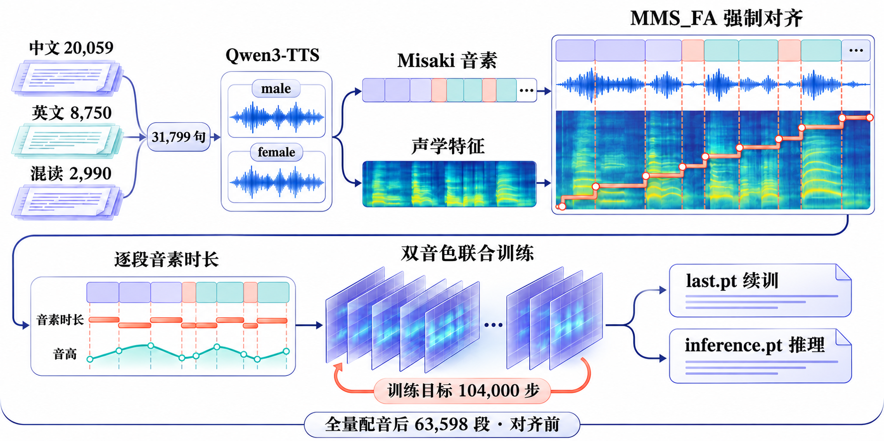
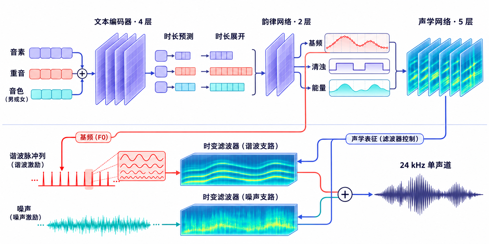

# tiny-voca-mix

tiny-voca-mix 用同一个轻量 TTS 模型训练男、女两位双语播音员。两种音色都面向普通话、英语和句内中英混读，例如「这个 weekend 我想去 hiking，你来吗？」。推理时用 `male` 或 `female` 选择音色，输出 24 kHz 单声道语音。

## 试听

男、女播音员的普通话、英语和中英混读样音待补。

## 从文本到双播音员检查点

1. **准备文本和标注。** 31,799 句原文包含普通话 20,059 句、英语 8,750 句、混读 2,990 句。每句使用一份 Misaki 音素和重音标注。训练、验证和测试按原句 ID 划分，两种音色沿用相同划分。[文本清单](dataset/) · [前端读音核验](docs/misaki-reading-evaluation.md)
2. **生成两套录音。** 将[文本与标注 ZIP](data/tiny-voca-mix-colab-31799.zip) 上传至 `MyDrive/tiny-voca-mix-qwen3-tts/downloads/`，运行[配音笔记本](notebooks/Qwen3-TTS-VoiceDesign-Tiny-Voca-Mix.ipynb)。Qwen3-TTS 为两位播音员各设计一段参考音，再分别朗读全量原文。可先勾选 `PREVIEW_ONLY` 检查音色。全量运行结束后执行导出单元，两份音频 ZIP 将写入 `MyDrive/tiny-voca-mix/downloads/`。
3. **对齐和训练。** 将同一个文本与标注 ZIP 也复制到 `MyDrive/tiny-voca-mix/downloads/`，再运行[训练笔记本](notebooks/Announcers-Bilingual-Tiny-Voca.ipynb)。笔记本从三个 ZIP 配对 63,598 段录音，用 CPU 多进程提取特征，用 GPU 分批计算 MMS_FA 对齐所需的输出。可设 `SMOKE = True` 试跑 80 步，全量训练目标为 104,000 步。[数据划分、参数与断点续训](docs/experiment.md)



## 模型架构

Misaki 0.9.4 将中文声调编码到韵母，逐音素标记英文重音。模型结合音素、重音和音色预测时长，再按帧预测基频、清浊音和能量。谐波与噪声两条支路合成最终波形。训练和推理使用相同的前端与词表。[双语前端](src/tiny_voca/text.py) · [模型实现](src/tiny_voca/model.py) · [混读实例图解](docs/announcers-tts/article.md)



## 在本地合成一句话

先从训练输出的 `checkpoints/` 目录取出 `inference.pt`，将下方路径换成实际位置。当前仓库提供训练材料，双播音员权重需由训练导出。

```bash
python3.10 -m venv .venv
source .venv/bin/activate
python -m pip install -r requirements-local.txt
export PYTHONPATH="$PWD/src"

python -m tiny_voca.local_infer --checkpoint /path/to/inference.pt \
  --voice female --text '这个 weekend 我想去 hiking，你来吗？' --output outputs/mixed.wav
python web/server.py --checkpoint /path/to/inference.pt
```

将 `--voice female` 改为 `--voice male` 可切换到男播音员。本地网页从已加载的检查点读取音色列表，与命令行共用 Python 推理入口。默认地址为 `http://127.0.0.1:8766/`。

[代码、文本与配音模型来源](NOTICE.md)

## 引用

### 上游项目

- Muhammed Nazeem 的 **tiny-voca** 提供了轻量语音合成模型和训练器。[项目仓库](https://github.com/n4ze3m/tiny-voca)
- xiaoliukuailiu 的 **tiny-voca-zh** 将模型适配到普通话。本项目的双语训练代码以该项目的 `7ec7434` 版本为基础。[项目仓库](https://github.com/xiaoliukuailiu/tiny-voca-zh) · [实验使用的版本](https://github.com/xiaoliukuailiu/tiny-voca-zh/tree/7ec7434bb052fcd6da8066e77f7d0e160586e095)

```bibtex
@software{nazeem2026tinyvoca,
  author = {Nazeem, Muhammed},
  title  = {tiny-voca: a 4.5M-parameter two-voice English text-to-speech model},
  year   = {2026},
  url    = {https://huggingface.co/n4ze3m/tiny-voca}
}

@software{tiny-voca-zh,
  title  = {tiny-voca-zh: a 4.5M-parameter two-voice Mandarin text-to-speech model},
  year   = {2026},
  url    = {https://github.com/xiaoliukuailiu/tiny-voca-zh}
}
```

### 相关论文

- Holy Lovenia 等，LREC 2022。实验选取 ASCEND 的中英混读对话转写，作为两位播音员的混读文本。[ASCEND: A Spontaneous Chinese-English Dataset for Code-switching in Multi-turn Conversation](https://aclanthology.org/2022.lrec-1.788/)
- Vineel Pratap 等，JMLR 2024。预处理使用 MMS 项目的多语言强制对齐模型，通过 TorchAudio 的 `MMS_FA` 定位录音里的中文音节和英文单词。[Scaling Speech Technology to 1,000+ Languages](https://jmlr.org/papers/v25/23-1318.html)
