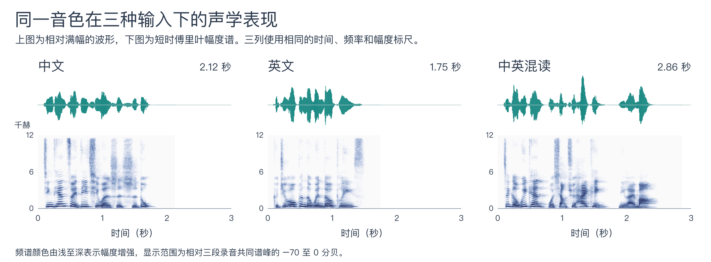

# 让 Vivian 读出「这个 weekend 我想去 hiking」：用 tiny-voca-zh 从零训练中英混读 TTS

「这个 weekend 我想去 hiking，你来吗？」我把这句话留到了训练结束。它只有十几个字词，却能一次听出三个问题：英文单词的重音落在哪里，切回中文时声调还在不在，以及一句话听起来像不像同一个人在说。[听 Vivian 朗读这句话，约 2.86 秒](assets/mixed.wav)

这次实验从 tiny-voca-zh 的中文语音合成代码出发，先把同一句里的汉字和英文词转成各自的发音，再用 **28.11 小时逐句配有文本的 Vivian 录音**从零训练模型。最终的 PyTorch 模型有 **4,575,499 个参数**，推理文件约 **18.37 MB**。合成新句子时，只需加载这一个模型，中文、英文和中英混读都由 Vivian 朗读。[tiny-voca-zh 项目](https://github.com/xiaoliukuailiu/tiny-voca-zh)


*图 1　Vivian 训练流程。阶梯线示意对齐位置随时间单调推进；对齐器先定位中文音节和英文单词，再估算组内音素时长。*

## 为同一个音色选三类文本

我们从三个来源选取文本，让 ElevenLabs 的多语言语音模型（`eleven_multilingual_v2`）用 Vivian 的声音逐句朗读，再把每段录音和原句配成一对。这样，中文、英文和句内混读样本共享同一位说话人；切换语种时，模型仍接收同一个音色 ID。

| 文本类型 | 文本怎么来 | 入选句数 | 录音时长 |
| --- | --- | ---: | ---: |
| 中文 | 从 tiny-voca-zh 中文语料记录中去重选取 | 20,059 | 21.551 小时 |
| 英文 | 从 tiny-voca 数据集的英文转写中选取 | 3,861 | 3.307 小时 |
| 句内混读 | 取 ASCEND 标为 `mixed` 的转写，保留真实对话里的语言切换 | 2,990 | 3.250 小时 |
| **合计** | **全部统一为 24 kHz、16 位 PCM、单声道 WAV** | **26,910** | **28.108 小时** |

英文文本来自 Muhammed Nazeem 发布的 tiny-voca 数据集。混读文本来自 Holy Lovenia 等人的 ASCEND，项目按 CC BY-SA 4.0 记录转写来源，并保留原始划分和行号。复现时，文本、合成录音和音色各有自己的使用条件；若使用合成服务，需要确认适用协议明确覆盖用输出训练模型的用途。[tiny-voca 数据卡](https://huggingface.co/datasets/n4ze3m/tiny-voca) · [ASCEND 论文](https://aclanthology.org/2022.lrec-1.788/) · [ASCEND 数据卡](https://huggingface.co/datasets/CAiRE/ASCEND) · [ElevenLabs 使用政策](https://elevenlabs.io/use-policy)

### 配对清单与数据划分

每条记录都保留原文、相对音频路径、音色、语种和划分。下面从真实测试清单中摘取一行，只保留与加载有关的字段：

```json
{"id":"zh-00f9de32704e4d63a87c05f3","text":"早上，他们在餐厅看了一本很有趣的书。","audio":"audio/zh/00f9de32704e4d63a87c05f3.wav","voice_id":"Vivian","language":"zh","split":"test"}
```

划分数据时，我们要避免同一句话既被模型练过，又出现在考题里。为此，我们先统一全角、半角和英文大小写，再比较文本。数字前的正负号要保留：如果把符号一律去掉，`-10 度` 和 `10 度` 就会被错当成同一句，录音里却相差一个「负」字。这些处理只用于查重，训练时仍保留原文。

最终，**25,592 条**用于训练，**619 条**用于在训练过程中检查模型表现，另留 **699 条**供训练结束后测试。这是对齐前的统计；后续处理会单独记录哪些录音无法可靠对齐。

## 让中文声调和英文重音进同一张词表

语音合成的第一步是把文字转成发音，这一步叫作「文本前端」。如果一句话只能选一种语言的读法，就会卡在「我的 hobby 是读书」这样的句子上。Vivian 的做法是先按连续汉字、英文词和标点切段，再把两种语言的发音按原句顺序接起来。中文按词组转拼音，拆成声母和带调韵母；英文用发音工具 eSpeak NG 拆成音素（区分发音的基本单位），同时保留重音。两种音素分别加 `zh/` 和 `en/` 前缀，和标点、边界符一起构成 **277 个符号**。

以这句 ASCEND 转写为例，实际前端产生的核心片段如下。括号列出英文元音的重音值：

```text
我      zh/uo3
的      zh/d   zh/e5
hobby   en/h   en/ɑː（主重音 1）  en/b   en/i
是      zh/sh  zh/i4
读书    zh/d   zh/u2   zh/sh   zh/u1
```

「读」的二声直接写在 `zh/u2` 里，`hobby` 的主重音则单独标在对应的元音上。训练标注和推理必须使用同一套转换。即便两个词表长度一样，只要其中一个音素的编号变了，权重读到的就是另一种发音。为此，笔记本会把本次使用的前端源码和训练检查点一起保存。

## 从一句 WAV，得到每个音素该占多少帧

文本告诉模型「读什么」，训练还需要告诉它「读多久」。以 `hobby` 为例，前端给出了四个音素，录音却只有一条连续波形。我们分两步建立它们的对应关系。

1. **先找音节和单词的位置。** 对 24 kHz 录音，每隔约 10.67 毫秒（256 个采样点）记录一次声音特征，得到一个声学帧。每帧记录基频和 80 个频带的能量分布，后者称为梅尔频谱。另取一份 16 kHz 的录音，交给 TorchAudio 的强制对齐工具 `MMS_FA`，让它沿着已知文本去录音里找每个音节或单词。中文用去声调的拼音拼写、英文用单词拼写作为对齐目标，让整句共享一条时间轴。声调仍保留在训练用的音素序列中。
2. **再估算组内音素时长。** 在每个音节或单词的对齐区间里均匀放置音素中心，用相邻中心的中点划分边界。标点和句界在空隙内插值，每个发音音素至少分到一帧。因此，单词边界有对齐模型支持，词内辅音、元音的精确边界仍是近似值。

保留一条样本前，程序会检查两件事：每个发音或停顿符号都有对应的时长，所有时长加起来恰好等于录音的总帧数。

```python
assert len(durations) == len(phones)
assert sum(durations) == acoustic_frames
```

每处理完 128 条录音，程序就把结果保存到 Google 云端硬盘，并记下哪些录音通过了检查、哪些失败以及失败原因。训练集、验证集和测试集都会分别检查中文、英文、混读样本的通过率，任一语种低于 80% 就停下来检查。混读只占全部数据的约 11%，单看总通过率，很容易错过只发生在混读前端的错误。

## 模型架构：从音素的长度到波形的形状


*图 2　Vivian 模型架构。上半图的色块数示意每个音素展开的帧数。下半图中，预测基频决定谐波脉冲间距，声学网络分别控制谐波和噪声支路的滤波器。*

先看图的上半部分。文本编码器把每个输入符号（包括音素和停顿标记）表示成一组 192 个数，让后续网络知道它在当前句子里的发音环境。时长预测器决定每个音素占几帧，也单独判断标点处是否需要停顿。假设一个元音占 9 帧，模型就把它的表示展开到 9 个位置，并加上帧在元音内部的相对位置。后面的网络由此可以学到同一个元音从起音到收尾的变化。

再看下半部分。帧级网络预测基频（F0）、清浊音和能量，并给出随时间变化的滤波器参数。谐波支路用 F0 控制脉冲间距，形成声音的周期性；噪声支路使用更短的帧移，让辅音等快速变化的成分也能被刻画。两路各自滤波，再把波形逐点相加。对「读」这个字来说，二声是文本端的输入，基频随时间的起伏则是模型需要从录音中学出来的。

## 在 Colab A100 上训练 Vivian

打开配套的 Colab 笔记本，就能按顺序完成发音转换、录音对齐和模型训练。这三步需要的代码都已放在笔记本里。开始前，先准备好有权用于训练的录音，以及每段录音实际朗读的文字。[配套训练笔记本](../../notebooks/Vivian-Bilingual-Tiny-Voca.ipynb)

1. **准备压缩包。** ZIP 顶层为 `vivian-bilingual/`，其中放 `audio/`、三份样本清单和配置文件 `prepare-config.json`。训练、验证和测试清单分别命名为 `train.jsonl`、`validation.jsonl` 和 `test.jsonl`。每行按前面的 JSON 示例写一条录音，再加上句子的查重标识 `text_id`：同一句文本在不同清单里应得到同一个标识，这样笔记本才能发现重复。配置写成 `{"speakers":["Vivian"]}`。把 ZIP 放到 `MyDrive/tiny-voca-zh/downloads/vivian-bilingual.zip`。
2. **先试跑。** 在 Colab 的运行时设置中选择 A100 GPU，设 `SMOKE = True`，依次运行单元。笔记本安装 Python 3.11、配套的 Torch/TorchAudio 2.8.0 和 eSpeak NG，从三类语料各取 8 条训练、2 条验证和 2 条测试，跑 80 步。此时试听的用途是验证整条链路能输出 WAV。
3. **运行全量训练。** 把 `SMOKE` 改为 `False` 后从头执行。全量目标为 104,000 步，程序将长短不同的录音分批送入模型，每批最多 16 条。计算时，较短的录音需要补齐到这一批中最长录音的帧数；补齐后每批总计最多 4,000 帧。笔记本会按批读取所需特征。模型学习音素时长和韵律，再由帧级网络和源滤波合成模块生成波形。
4. **保存与试听。** 每 500 步，程序把当前训练进度存进 `last.pt`，以后可以从这里接着练。每 10,000 步还会单独留一份快照。本次模型完成了 **104,000 步**训练。要让它读一句新话，加载同目录的语音合成模型 `inference.pt`，搭配训练时保存的发音转换代码即可。

训练时，模型会把自己的预测和配对录音放在一起比较：每个音读了多久，音高在哪里上扬或下降，各个频带的能量分布是否接近原声。从第 8,000 步起，还会训练一个判别器，让它学习区分参考录音和生成语音。合成模型利用判别器的反馈继续调整声音细节。训练结束后，读新句子只需加载合成模型。

## 让训练好的 Vivian 读三句话

训练完成后，打开笔记本末尾的「用检查点试听」单元。它已经填好了模型路径和音色。想让 Vivian 读自己的句子，只需替换下面 `--text` 后面的文字，运行后就能在笔记本里播放。

```python
from IPython.display import Audio, display

wav = WORK / "vivian-mixed.wav"
run(PY, "-m", "tiny_voca.infer",
    "--checkpoint", checkpoint, "--voice", "Vivian",
    "--text", "这个 weekend 我想去 hiking，你来吗？",
    "--output", wav)
display(Audio(filename=str(wav)))
```

下面三段由同一份 **104,000 步权重**在本机重新合成，语速均为 1.0。可以先听纯中文和纯英文建立参照，再听第三句里的两次英文插入。

| 输入 | 建议留意的位置 | 实际输出 |
| --- | --- | --- |
| 今天最低气温是负十度。 | 「负十度」三个字能否逐字辨认 | [试听中文 · 2.12 秒](assets/zh.wav) |
| Could you open the window, please? | `window` 的重音，以及 `please` 前的停顿 | [试听英文 · 1.75 秒](assets/en.wav) |
| 这个 weekend 我想去 hiking，你来吗？ | `weekend 我`、`hiking，你` 两处切回中文时的节奏 | [试听混读 · 2.86 秒](assets/mixed.wav) |



*图 3　三段试听录音的实测波形与频谱。每列上下共用时间轴，可以将波形中的停顿与同一时刻的频谱变化对照起来。*

这三条样音验证了同一音色可以走通三种输入。要进一步评价质量，还需要在留出的测试集上分别检查中文错字、英文漏词，并让听者标出混读句中不自然的停顿或重音。本次没有 Vivian 的独立听评得分，图中展示的是三段试听录音的时长、停顿与频谱分布。

回到开头那句话：要让 Vivian 从「这个」读到 `weekend`，再回到「我想去」，关键工作发生在训练之前。语料中要真的有这种切换，前端要同时保住两侧的发音信息，对齐结果还要能把每个音素放回同一句录音。把这三件事做实，最后那个十几兆的检查点才能接收一行混合文本，直接读出整句话。
