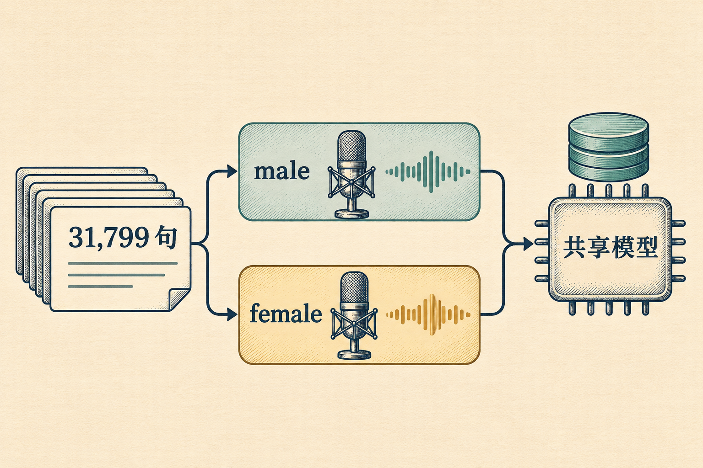
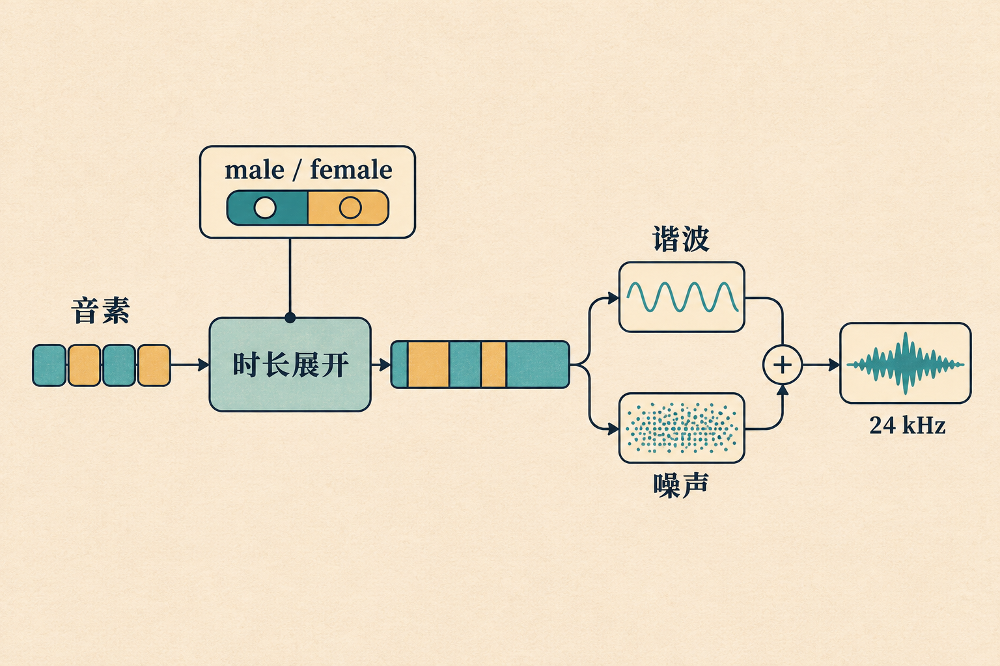

# 同一句中英混读，怎样训练两位播音员来读？

「这个 weekend 我想去 hiking，你来吗？」让男、女播音员分别读这句话，两人要读准的是同一组字词，但说出 `weekend` 花的时间、在问句末尾抬高多少音调，都可以不同。tiny-voca-mix 把这两类信息分开处理。两种音色共享文本标注，每段录音单独提供时长、音高和能量。

## 一句话，两条训练记录

语料有 20,059 句普通话、8,750 句英语和 2,990 句中英混读。三类文本分别来自 tiny-voca-zh、tiny-voca 和 ASCEND。先按原句划分训练、验证和测试集，再为每句配两种声音。这样，即使换了播音员，测试句也不会作为另一种音色的训练样本出现。[文本清单与来源](../../dataset/README.md)

配音时，Qwen3-TTS VoiceDesign 根据描述生成一段男播音员参考音和一段女播音员参考音。Base 模型使用各自的参考音朗读同一份原文。纯中文、纯英文分别指定 Chinese、English，混读句使用 Auto，一次读完整句。全量配音后，31,799 句对应 63,598 段待对齐录音。[配音笔记本](../../notebooks/Qwen3-TTS-VoiceDesign-Tiny-Voca-Mix.ipynb)

## 「我的hobby是读书」如何变成输入

这是混读清单中的真实句子，ID 为 `mixed-5cc1c2d831031798b4c952b8`。下表摘自它的 Misaki 标注，省略句界和空格标记。[全量音素标注](../../dataset/phonemes/misaki.jsonl)

| 原文 | 音素 | 发音信息 |
| --- | --- | --- |
| 我的 | `zh/uo3 zh/d zh/e5` | 「我」为三声，「的」为轻声 |
| hobby | `en/h en/ɑː en/b en/i` | 第一个元音的重音值为 1 |
| 是读书 | `zh/sh zh/i4 zh/d zh/u2 zh/sh zh/u1` | 「读」和「书」的韵母分别带二声和一声 |

两位播音员共用这一行音素和重音。训练还需要知道每个音占多少帧。预处理先用 MMS_FA 在每段录音里定位音节或英文单词，再在区间内估算各音素的边界。因此，即使两位播音员的 `hobby` 时长不同，模型也能拿到各自的时长标注。[时长对齐实现](../../scripts/preprocess.py)

## 从音素时长到 24 kHz 波形

读新句子时，编码器一起接收音素、重音和所选播音员的音色向量。时长预测器决定每个音素占几帧。展开后，模型再次加入音色信息和音素内部的帧位置，逐帧预测基频、清浊音和能量。谐波支路用基频控制周期成分，噪声支路生成非周期成分。两路滤波后相加，输出 24 kHz 单声道波形。[模型实现](../../src/tiny_voca/model.py)

训练时可以先用 80 步试跑检查数据配对、对齐和模型保存，再启动目标为 104,000 步的全量训练。推理时给同一份检查点传入 `--voice male` 或 `--voice female`，即可用相同文本比较两种音色。[Colab 复现步骤](../experiment.md) · [本地合成命令](../../README.md#在本地合成一句话)

## 试听

男、女播音员样音待补。以下是训练笔记本用于试听的三句文本。

| 类型 | 文本 | 可听辨的位置 |
| --- | --- | --- |
| 普通话 | 今天最低气温是负十度。 | 「负十度」的声调 |
| 英语 | Could you open the window, please? | window 的词重音、please 前的停顿 |
| 中英混读 | 这个 weekend 我想去 hiking，你来吗？ | 两次从英文切回中文时的节奏 |
